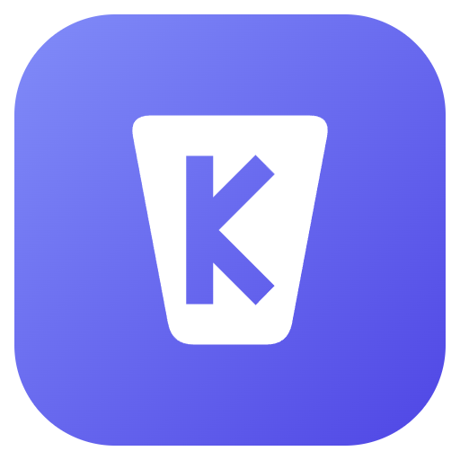
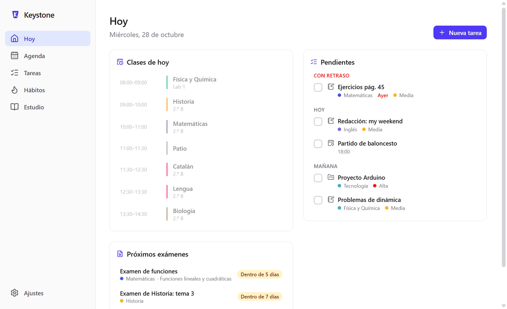
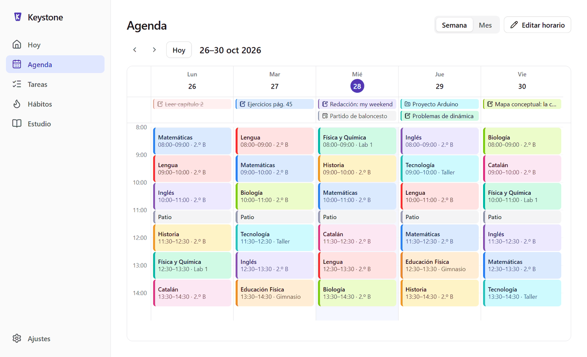
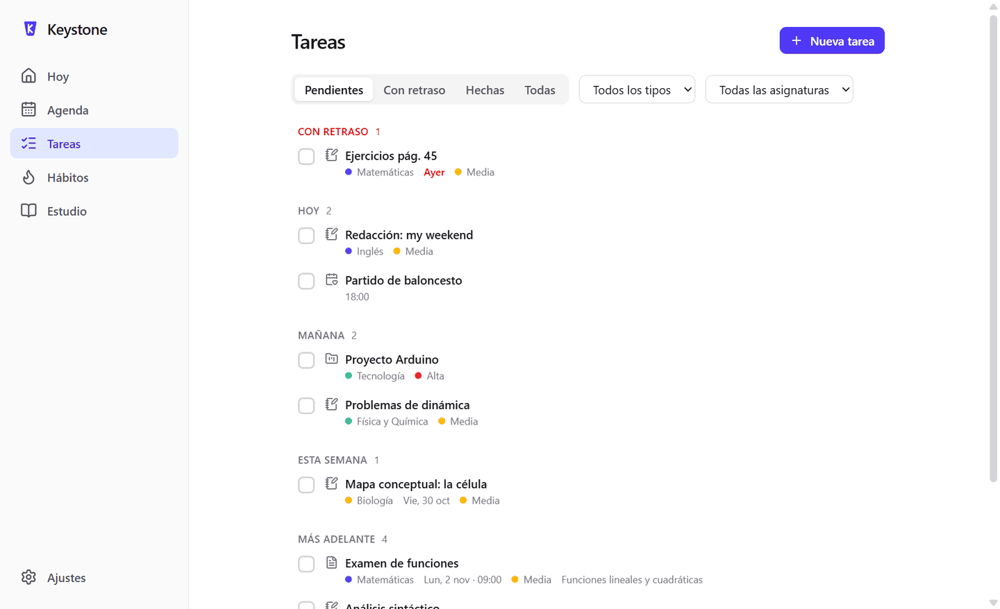
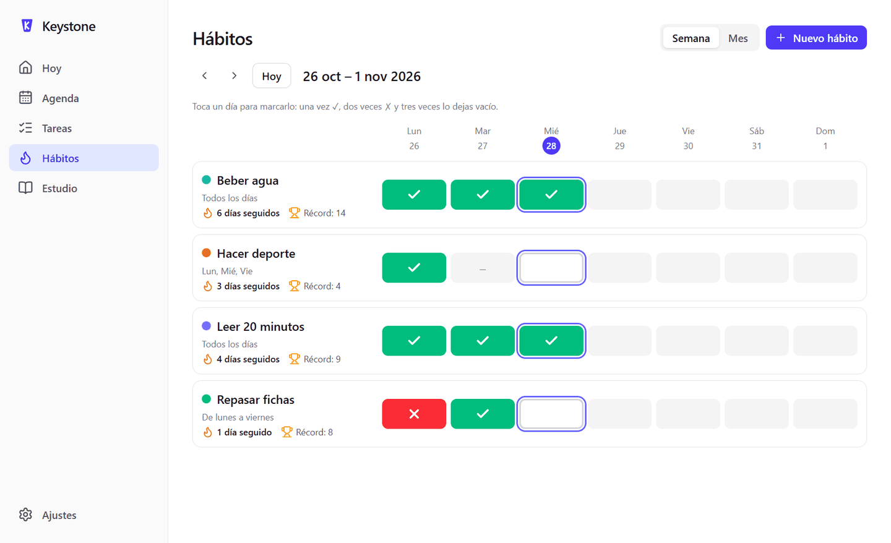
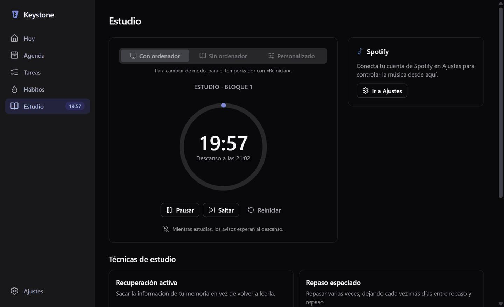
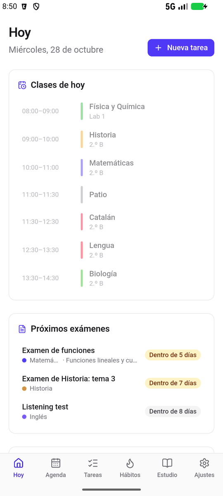
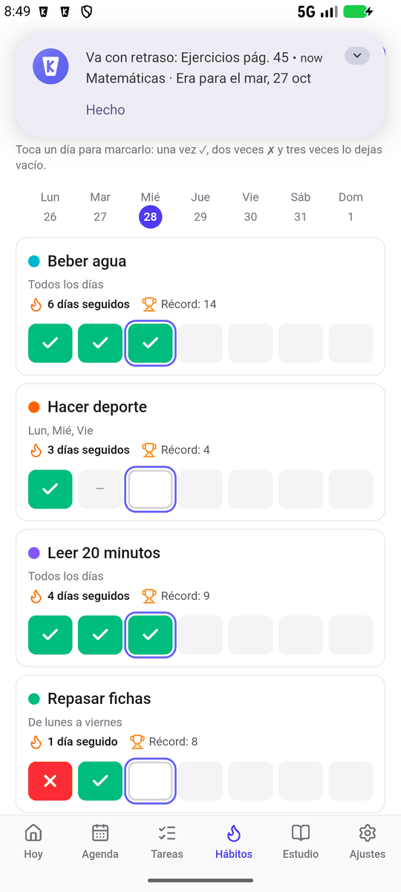

<div align="center">



# Keystone

**Tu semana de clase en un solo sitio: horario, deberes, exámenes, avisos, hábitos y un
temporizador de estudio. Para Windows y Android.**

[](https://github.com/zxk1019/Keystone/actions/workflows/ci.yml)
[](https://github.com/zxk1019/Keystone/releases/latest)
[](#descarga)
[](LICENSE)

[English](README.md) · Español



</div>

## Qué hace

- **Hoy**: las clases del día con la actual destacada, lo que hay que entregar hoy y mañana,
  los deberes con retraso y los próximos exámenes.
- **Agenda**: horario semanal con las asignaturas por colores y una vista del mes con todos
  los deberes, exámenes, trabajos y eventos.
- **Tareas**: deberes, exámenes, trabajos y eventos con prioridad, temas y filtros.
- **Avisos**: un resumen diario, los exámenes unos días antes, lo que va con retraso y horas de
  silencio. Marca una tarea como hecha desde el propio aviso. En el móvil llegan también con la
  app cerrada.
- **Hábitos**: marca cada día con un tic o una cruz en la vista de semana o de mes, con la racha
  actual y el récord.
- **Zona de estudio**: temporizador con tres modos (la regla 20-20-20 para estudiar con
  pantalla, 45 + 5 sin pantalla o tus propios tiempos), técnicas de estudio y control de
  Spotify, que pausa la música en los descansos.
- **Descanso de la vista**: cada 20 minutos de ordenador (los tiempos se pueden cambiar), una
  pantalla oscura en cada monitor te recuerda mirar lejos durante 20 segundos. Espera si estás
  jugando o presentando a pantalla completa.
- **Sincronización entre el PC y el móvil** con tu propio proyecto de Firebase, gratis
  (opcional).
- **Privada**: tus datos se quedan en tus dispositivos y en tu propio proyecto de Firebase. Sin
  cuentas nuestras, sin telemetría y sin anuncios.
- Tema claro y oscuro, en español, inglés y chino simplificado.
- **Se actualiza sola** en el PC, y el móvil avisa cuando hay una versión nueva.

## Capturas

<table>
  <tr>
    <td></td>
    <td></td>
  </tr>
  <tr>
    <td align="center">Agenda</td>
    <td align="center">Tareas</td>
  </tr>
  <tr>
    <td></td>
    <td></td>
  </tr>
  <tr>
    <td align="center">Hábitos</td>
    <td align="center">Zona de estudio (tema oscuro)</td>
  </tr>
</table>

<p align="center">
  
  &nbsp;&nbsp;
  
</p>

## Descarga

Descarga la última versión desde la
**[página de Releases](https://github.com/zxk1019/Keystone/releases/latest)**.

| Plataforma                | Archivo                        |
| ------------------------- | ------------------------------ |
| Windows 10 / 11 (64 bits) | `keystone-<versión>-setup.exe` |
| Android 7.0 o posterior   | `keystone-<versión>.apk`       |

Cada versión trae también un archivo `SHA256SUMS.txt` para comprobar las descargas.

### Windows

Abre `keystone-<versión>-setup.exe`. Se instala solo para tu usuario, sin permisos de
administrador, y abre Keystone al acabar.

> [!NOTE]
> El instalador no está firmado, así que SmartScreen puede decir que «ha protegido tu PC».
> Haz clic en **Más información** → **Ejecutar de todas formas**. Antes puedes comprobar el
> archivo con `SHA256SUMS.txt`.

Al cerrar la ventana, Keystone sigue en la bandeja para que los avisos lleguen siempre. En
**Ajustes** puedes hacer que arranque con Windows. Al desinstalarla se conservan tus datos en
`%APPDATA%\Mi Estudio`.

### Android

Abre la página de la versión en el móvil, descarga `keystone-<versión>.apk` y ábrelo. La
primera vez, Android pide permiso para instalar apps desde el navegador. Después, permite los
avisos cuando Keystone lo pida, para que lleguen a su hora.

## Actualizaciones

- **PC**: Keystone busca una versión nueva al arrancar y cada 6 horas, la descarga en segundo
  plano y la instala la próxima vez que arranca. Un aviso arriba te deja reiniciar en ese
  momento. También puedes buscarla en **Ajustes → Actualizaciones**.
- **Móvil**: al abrir Keystone mira si hay una versión nueva y te ofrece descargar el APK.
  Instálalo encima del que tienes: los datos se quedan.

## Sincronizar el PC y el móvil

La sincronización es opcional. Tus datos van a tu propio proyecto de Firebase (el plan gratuito
Spark sobra), así que nadie más los guarda. La guía completa, con botones para abrir la consola
y copiar las reglas, está en **Ajustes → Sincronización**. En resumen:

1. Crea un proyecto en la [consola de Firebase](https://console.firebase.google.com/) (no hace
   falta Google Analytics).
2. En **Authentication**, activa el proveedor **Correo electrónico/contraseña**.
3. En **Firestore Database**, crea una base de datos en modo de producción.
4. En la pestaña **Reglas**, pega las reglas de
   [`firebase/firestore.rules`](firebase/firestore.rules) y publícalas. Solo dejan que cada
   cuenta lea y escriba sus propios datos.
5. Copia el **ID del proyecto** y la **clave de API web** de la configuración del proyecto en
   Keystone.
6. Crea tu cuenta en Keystone y entra con el mismo correo en el otro dispositivo.

Se sincronizan las asignaturas, el horario, las tareas, los hábitos y los ajustes compartidos.
Si lo mismo cambia en los dos dispositivos, gana el último cambio.

## Spotify (opcional)

En el PC, la pantalla Estudio puede controlar tu Spotify Premium (reproducir, pausar, siguiente,
volumen y una playlist de estudio) y pausar la música en los descansos. La música suena en tu
propia app de Spotify.

1. Abre el [panel de desarrolladores de Spotify](https://developer.spotify.com/dashboard) y haz
   clic en **Create app**.
2. Añade la Redirect URI `http://127.0.0.1:43821/callback` y marca **Web API**.
3. Copia el **Client ID** en **Ajustes → Spotify** y haz clic en **Conectar con Spotify**.

Keystone usa PKCE, así que nunca necesita el Client Secret: no lo compartas. En el móvil,
Keystone solo abre la app de Spotify en tu playlist de estudio.

## Compilarla tú

Necesitas Windows, [Node.js 24](https://nodejs.org/) y Git. Para la app de Android, también
Android Studio y Java 21.

```bash
git clone https://github.com/zxk1019/Keystone.git
cd Keystone
npm install
npm run dev            # la app del PC en modo desarrollo
npm test               # tests
npm run build:win      # instalador de Windows en dist/
```

En [CONTRIBUTING.md](CONTRIBUTING.md) (en inglés) están todos los comandos, cómo está organizado
el código, cómo probar sin tocar tus datos y cómo se publican las versiones.

## Hecha con

[Electron](https://www.electronjs.org/), [React](https://react.dev/),
[TypeScript](https://www.typescriptlang.org/), [Tailwind CSS](https://tailwindcss.com/),
[Capacitor](https://capacitorjs.com/) para Android, [Firebase](https://firebase.google.com/)
(Authentication y Firestore, con sus API REST) para sincronizar,
[electron-updater](https://www.electron.build/auto-update) para las actualizaciones y
[Vitest](https://vitest.dev/) para los tests.

## Colaborar y seguridad

Los errores y las ideas son bienvenidos en [Issues](https://github.com/zxk1019/Keystone/issues).
Lee [CONTRIBUTING.md](CONTRIBUTING.md) antes de abrir un pull request. Para avisar de un problema
de seguridad en privado, sigue [SECURITY.md](SECURITY.md).

Los cambios de cada versión están en [CHANGELOG.md](CHANGELOG.md).

## Licencia

[MIT](LICENSE) © 2026 Xinkai Zheng
