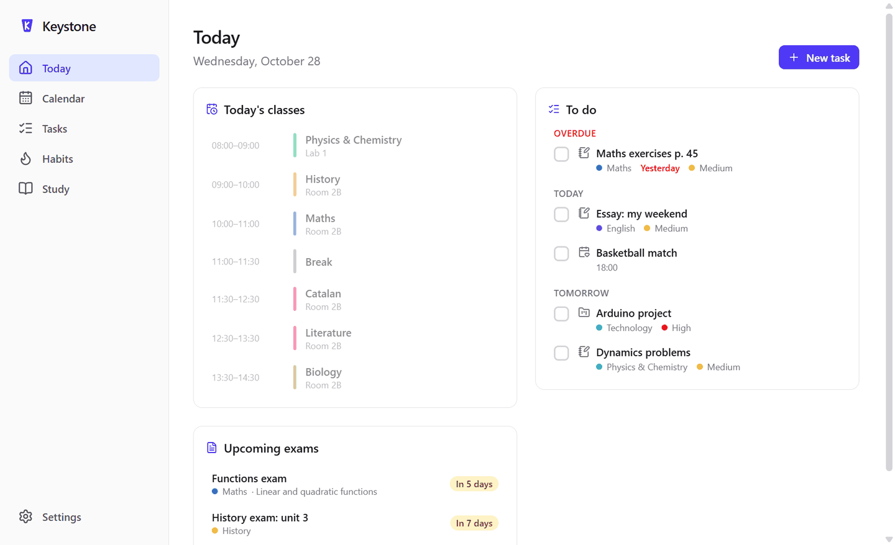
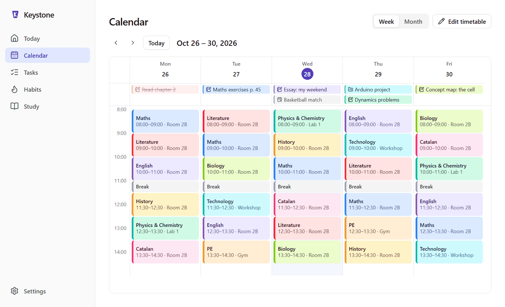
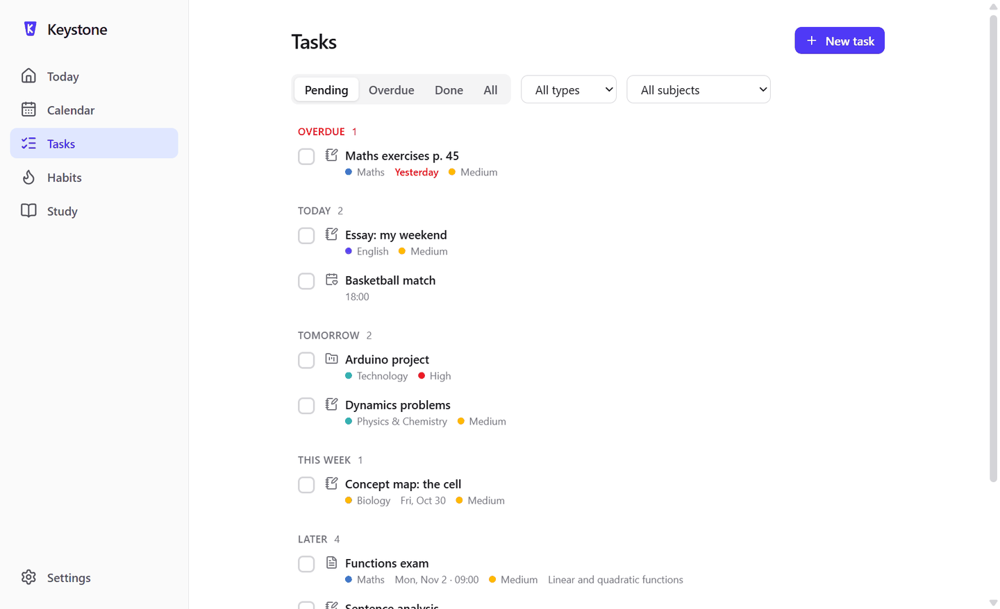
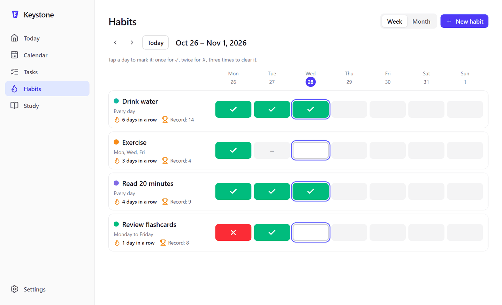
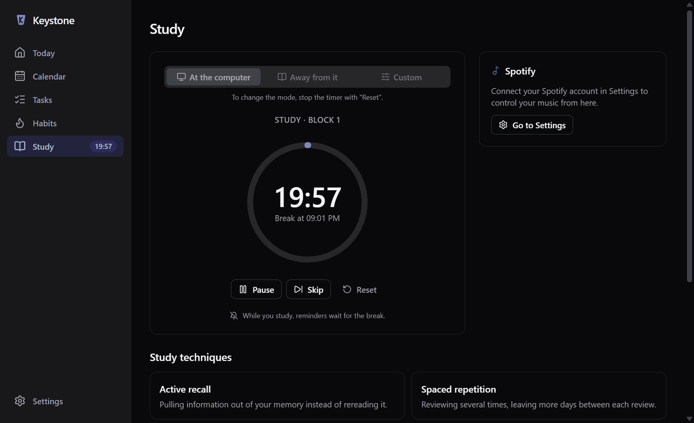
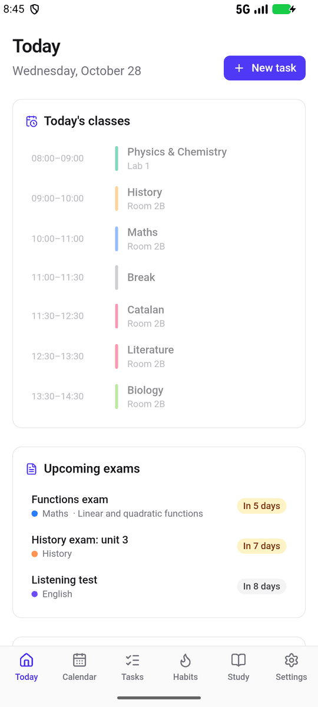
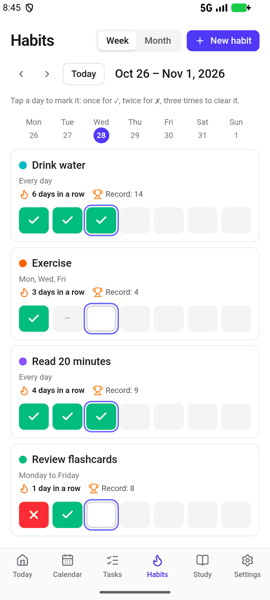

<div align="center">


# Keystone

**Your school week in one place: timetable, homework, exams, reminders, habits and a study
timer. For Windows and Android.**

[](https://github.com/zxk1019/Keystone/actions/workflows/ci.yml)
[](https://github.com/zxk1019/Keystone/releases/latest)
[](#download)
[](LICENSE)

English · [Español](README.es.md)



</div>

## Features

- **Today**: the classes of the day with the current one highlighted, what is due today and
  tomorrow, overdue homework and the next exams.
- **Agenda**: a weekly timetable with colored subjects, and a month view with all your
  homework, exams, projects and events.
- **Tasks**: homework, exams, projects and events with priorities, topics and filters.
- **Reminders**: a daily summary, exams a few days before, overdue work and quiet hours. Mark a
  task as done straight from the notification. They also arrive on the phone with the app
  closed.
- **Habits**: tick or cross each day on a week or month view, with your current streak and
  your record.
- **Study zone**: a study timer with three modes (the 20-20-20 rule for screen work, 45 + 5
  without a screen, or your own times), study techniques, and Spotify controls that pause the
  music during breaks.
- **Eye breaks**: every 20 minutes at the computer (you can change the times), a dark screen on
  every monitor reminds you to look far away for 20 seconds. It waits if you are playing or
  presenting in full screen.
- **Sync between PC and phone** through your own free Firebase project (optional).
- **Private by design**: your data stays on your devices and in your own Firebase project. No
  accounts on our side, no telemetry, no ads.
- Light and dark themes, in English, Spanish and Simplified Chinese.
- **Automatic updates** on the PC, and a new-version notice on the phone.

## Screenshots

<table>
  <tr>
    <td></td>
    <td></td>
  </tr>
  <tr>
    <td align="center">Agenda</td>
    <td align="center">Tasks</td>
  </tr>
  <tr>
    <td></td>
    <td></td>
  </tr>
  <tr>
    <td align="center">Habits</td>
    <td align="center">Study zone (dark theme)</td>
  </tr>
</table>

<p align="center">
  
  &nbsp;&nbsp;
  
</p>

## Download

Get the latest version from the
**[Releases page](https://github.com/zxk1019/Keystone/releases/latest)**.

| Platform                 | File                           |
| ------------------------ | ------------------------------ |
| Windows 10 / 11 (64-bit) | `keystone-<version>-setup.exe` |
| Android 7.0 or later     | `keystone-<version>.apk`       |

Each release also has a `SHA256SUMS.txt` file to check the downloads.

### Windows

Run `keystone-<version>-setup.exe`. It installs for your user only, without administrator
rights, and opens Keystone when it finishes.

> [!NOTE]
> The installer is not code-signed, so Windows SmartScreen may say that it "protected your
> PC". Click **More info** → **Run anyway**. You can check the file against
> `SHA256SUMS.txt` first.

Keystone keeps running in the tray when you close the window, so reminders always arrive. You
can make it start with Windows in **Settings**. Uninstalling keeps your data in
`%APPDATA%\Mi Estudio`.

### Android

Open the release page on your phone, download `keystone-<version>.apk` and open it. Android
asks you to allow installing apps from your browser the first time. Then allow notifications
when Keystone asks, so reminders arrive on time.

## Updates

- **PC**: Keystone looks for a new version when it starts and every 6 hours, downloads it in
  the background and installs it the next time it starts. A banner lets you restart right
  away. You can also check in **Settings → Updates**.
- **Phone**: when you open Keystone it checks for a new version and offers to download the new
  APK. Install it over the current one: your data stays.

## Sync between your PC and your phone

Sync is optional. Your data goes to your own Firebase project (the free Spark plan is more
than enough), so nobody else stores it. The full guide, with buttons to open the console and
copy the rules, is in **Settings → Sync**. In short:

1. Create a project in the [Firebase console](https://console.firebase.google.com/) (Google
   Analytics is not needed).
2. In **Authentication**, enable the **Email/Password** provider.
3. In **Firestore Database**, create a database in production mode.
4. In the **Rules** tab, paste the rules of [`firebase/firestore.rules`](firebase/firestore.rules)
   and publish them. They only let each account read and write its own data.
5. Copy the **Project ID** and the **Web API Key** from the project settings into Keystone.
6. Create your account in Keystone and sign in with the same email on your other device.

Subjects, timetable, tasks, habits and the shared settings sync. If the same thing changes on
both devices, the last change wins.

## Spotify (optional)

On the PC, the Study screen can control your Spotify Premium (play, pause, next, volume and a
study playlist), and pause the music during breaks. The music plays in your own Spotify app.

1. Open the [Spotify developer dashboard](https://developer.spotify.com/dashboard) and click
   **Create app**.
2. Add the Redirect URI `http://127.0.0.1:43821/callback` and tick **Web API**.
3. Copy the **Client ID** into **Settings → Spotify** and click **Connect to Spotify**.

Keystone uses PKCE, so it never needs the Client Secret: do not share it. On the phone,
Keystone simply opens the Spotify app on your study playlist.

## Build from source

You need Windows, [Node.js 24](https://nodejs.org/) and Git. For the Android app, also Android
Studio and Java 21.

```bash
git clone https://github.com/zxk1019/Keystone.git
cd Keystone
npm install
npm run dev            # the PC app in development mode
npm test               # unit tests
npm run build:win      # Windows installer in dist/
```

See [CONTRIBUTING.md](CONTRIBUTING.md) for all the commands, how the code is organized, how to
test without touching your own data and how releases are made.

## Built with

[Electron](https://www.electronjs.org/), [React](https://react.dev/),
[TypeScript](https://www.typescriptlang.org/), [Tailwind CSS](https://tailwindcss.com/),
[Capacitor](https://capacitorjs.com/) for Android, [Firebase](https://firebase.google.com/)
(Authentication and Firestore, through their REST APIs) for sync,
[electron-updater](https://www.electron.build/auto-update) for updates and
[Vitest](https://vitest.dev/) for the tests.

## Contributing and security

Bug reports and ideas are welcome in [Issues](https://github.com/zxk1019/Keystone/issues).
Read [CONTRIBUTING.md](CONTRIBUTING.md) before opening a pull request. To report a security
problem privately, follow [SECURITY.md](SECURITY.md).

The changes of each version are in [CHANGELOG.md](CHANGELOG.md).

## License

[MIT](LICENSE) © 2026 Xinkai Zheng
